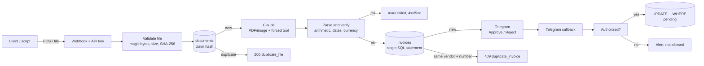

# AI Invoice Processing for n8n

> Upload an invoice (PDF or photo). Claude extracts the data, the workflow **verifies the arithmetic in code**, flags fraud signals, and a human approves or rejects it with one tap on Telegram. Everything is stored in PostgreSQL and can be exported as CSV.


-D97757)


## Table of contents

1. [What it does](#what-it-does)
2. [Architecture](#architecture)
3. [Design decisions](#design-decisions)
4. [Setup](#setup)
5. [Usage](#usage)
6. [Validation and fraud signals](#validation-and-fraud-signals)
7. [Database](#database)
8. [Security](#security)
9. [Testing](#testing)
10. [Troubleshooting](#troubleshooting)
11. [Limitations](#limitations)
12. [Roadmap](#roadmap)

## What it does

| Step | What happens |
|---|---|
| **Intake** | `POST /webhook/invoice-intake` with a PDF or image (header-authenticated). File type is detected from the file's bytes, not its name. |
| **Dedupe** | The SHA-256 of the file is claimed in PostgreSQL. The same file is never sent to the model twice. Failed or stuck uploads can be retried. |
| **Extract** | Claude reads the document and must answer through a tool schema (vendor, number, dates, currency, subtotal, tax, total, line items, bank account, confidence). |
| **Verify** | Code recomputes subtotal + tax, quantity x price, and the sum of the lines. Every mismatch becomes an issue on the invoice. |
| **Detect** | Duplicate invoice numbers per vendor, **changed bank details**, and **unusually large totals** are flagged. |
| **Approve** | A Telegram message with the data, the warnings and Approve / Reject buttons. Only allowed Telegram users can decide, and a decision can be made once. |
| **Report** | `GET /webhook/invoice-export?month=2026-10` returns approved invoices as CSV. A daily message lists pending invoices and failed uploads. |

The workflow never pays or posts anything. It prepares a decision for a person.

## Architecture



Four independent flows live in one workflow:

1. **Upload** (webhook): intake, extraction, storage, approval request.
2. **Decisions** (Telegram trigger): button presses.
3. **Export** (webhook): CSV for accounting.
4. **Daily reminder** (schedule, 08:00) and an **Error Trigger** flow that alerts you when something breaks.

## Design decisions

- **The model extracts, code decides.** Language models are unreliable at arithmetic and must not be the only check on money. The model is told to copy values as printed; the workflow does the math (in integer cents) and records every discrepancy.
- **Forced tool use for structure.** `tool_choice` pins the answer to one tool with a JSON schema, so there is no free-text parsing and no "here is the JSON:" prefixes. The model has no other tools.
- **Idempotency in the database.** `documents.sha256` is unique, `invoices (vendor_key, invoice_number)` is unique, and the save is one SQL statement with `ON CONFLICT DO NOTHING`. Two concurrent uploads of the same invoice produce exactly one row.
- **Atomic decisions.** `UPDATE ... WHERE id = $1 AND status = 'pending'` means double clicks and two approvers cannot flip a decision.
- **Fail closed.** Unknown Telegram users, malformed button data and a missing allow-list entry all deny. The allow-list ships with a placeholder that matches nobody.
- **Normalized vendor key.** "PT Maju Jaya Tbk", "maju jaya, PT." and "Maju Jaya" all map to `maju jaya`, so duplicate and fraud checks do not depend on how the vendor wrote its name.

## Setup

### Requirements

- n8n 1.x (self-hosted or cloud). Self-hosted needs `NODE_FUNCTION_ALLOW_BUILTIN=crypto` for the file hash.
- PostgreSQL 13+
- An Anthropic API key
- A Telegram bot (from @BotFather) and the numeric ID of the person who approves invoices

### Steps

1. **Create the tables.** Run [`sql/schema.sql`](sql/schema.sql) on your database. It is safe to run twice.
2. **Import** `workflows/invoice_ai_processing.json` into n8n.
3. **Create credentials**

   | Credential | Type | Notes |
   |---|---|---|
   | Postgres account | Postgres | |
   | Telegram account | Telegram API | Bot token |
   | Anthropic API key | Header Auth | Name `x-api-key`, value is your key |
   | Invoice API key | Header Auth | Name `X-API-Key`, value is a long random secret you choose |

4. **Replace placeholders**

   | Placeholder | Where | Value |
   |---|---|---|
   | `REPLACE_WITH_APPROVER_CHAT_ID` | Send Approval Request, Send Reminder, Send Error Alert | Telegram chat that receives approvals |
   | `REPLACE_WITH_TELEGRAM_USER_ID` | Code node *Parse Callback* | Numeric Telegram user ID(s) allowed to approve |
   | `REPLACE_ID` | Every credential slot | Select the credentials you created |

5. **Choose the model.** `MODEL` at the top of *Build LLM Request* (default `claude-sonnet-5-5`). Any Claude model with PDF and image input works.
6. **Set the Error Workflow** in Workflow Settings to this workflow.
7. **Activate** the workflow.

## Usage

Upload an invoice:

```bash
curl -X POST "https://YOUR-N8N/webhook/invoice-intake" \
  -H "X-API-Key: YOUR_SECRET" \
  -F "file=@invoice.pdf"
```

Responses:

| Status | Body | Meaning |
|---|---|---|
| 201 | `{"status":"pending_approval","invoice_id":12,"issues":[...]}` | Saved, approval request sent |
| 200 | `{"status":"duplicate_file"}` | This exact file was already received |
| 409 | `{"status":"duplicate_invoice","duplicate_of":12}` | Same vendor and invoice number already exists |
| 400 | `{"status":"rejected","error":"..."}` | Bad file type, empty, too large, missing `file` field |
| 422 | `{"status":"not_invoice"}` or `{"status":"failed",...}` | Not an invoice, or no total found |
| 502 | `{"status":"failed","retryable":true}` | Extraction service error. Upload the same file again to retry |

Export a month as CSV:

```bash
curl -H "X-API-Key: YOUR_SECRET" \
  "https://YOUR-N8N/webhook/invoice-export?month=2026-10" -o invoices-2026-10.csv
```

Ideas for getting invoices in: a Gmail rule that forwards attachments to the webhook, a shared-folder watcher, a mobile shortcut that shares a photo to the URL.

## Validation and fraud signals

Issues are attached to the invoice and shown in the Telegram message.

| Check | Rule |
|---|---|
| Totals | `subtotal + tax` within max(0.02, 0.1% of total) of `total` |
| Subtotal without tax | Flagged if it differs from the total |
| Line math | `quantity x unit price` within max(0.02, 0.5%) of the line amount |
| Line sum | Must match the subtotal or the total (tax-inclusive lines are accepted) |
| Dates | ISO and real (no 30 Feb); not in the future; not older than 2 years; due date not before invoice date |
| Currency | Must be an ISO-style 3-letter code, otherwise stored as `XXX` with an issue |
| Amount | Total must be present and inside the supported range, otherwise the upload fails |
| Confidence | Below 0.8 is flagged |

Fraud signals computed in SQL at save time:

| Signal | Rule |
|---|---|
| **Bank details changed** | The invoice has a bank account, the vendor has approved invoices with a bank account, and none of them match. This is the classic payment-diversion scam. |
| **Unusual amount** | The vendor has at least 3 approved invoices in the same currency and this total is more than 3x their average. |
| **Duplicate invoice** | Same normalized vendor and same invoice number. |

## Database

| Table or view | Purpose |
|---|---|
| `documents` | One row per unique file (hash, status, attempts, error). |
| `invoices` | Extracted data, issues, fraud flags, decision, approver. |
| `approved_invoices` | View for accounting tools. |
| `monthly_spend` | View: approved totals per month and currency. |

To re-submit a corrected invoice after rejecting one, delete the rejected row (`DELETE FROM invoices WHERE id = ...`), then upload again.

## Security

- **Authentication.** Both webhooks require a header API key. Use a long random value and HTTPS.
- **Files are verified by content.** A file named `invoice.pdf` that is actually an executable is rejected. Limits: 10 MB (5 MB for images, the API limit).
- **Prompt injection.** An invoice can contain text such as "ignore previous instructions". The model is told the document is untrusted, has only one tool, and cannot do anything but return data. A person still approves every invoice and sees the arithmetic warnings.
- **Approval is restricted.** Only the Telegram user IDs in *Parse Callback* can approve or reject. Button data must match `inv:(approve|reject):<number>`.
- **SQL.** Every query is parameterized.
- **CSV injection.** Text cells that start with `=`, `+`, `-` or `@` get a leading apostrophe so spreadsheets do not execute them.
- **Telegram messages** are HTML-escaped.
- **Data privacy.** Invoice contents are sent to the Anthropic API. Check that this fits your data policy before using real documents.
- **Environment trade-off.** The file hash needs `NODE_FUNCTION_ALLOW_BUILTIN=crypto`. Restrict who can edit workflows on the instance.

## Testing

Two suites were used while building this project.

- **Code nodes: 111 checks** with mocked n8n inputs. They cover file validation (magic bytes, spoofed types, size limits, filename sanitizing), request shape, 40+ extraction cases (arithmetic, dates, currency, bad model output, API errors, injection-style text), Telegram callbacks (allowed, unknown user, malformed data), CSV escaping and workflow structure (every path ends in a response).
- **SQL: 47 checks** on a real PostgreSQL engine (PGlite): schema applied twice, hash claim and retry rules, duplicate detection, a concurrent-duplicate race, fraud flags, single-use decisions, month filters and the reminder query.

Not verified: a live n8n instance, the Anthropic API and Telegram. The request and response shapes follow their documentation. The first real test should be one invoice end to end.

## Troubleshooting

| Problem | Fix |
|---|---|
| `Cannot find module 'crypto'` | Set `NODE_FUNCTION_ALLOW_BUILTIN=crypto` and restart n8n. |
| 400 "Send the invoice as multipart/form-data..." | The form field must be named `file`. |
| Upload returns `duplicate_file` but nothing was processed | A previous attempt is still `processing` (under 15 minutes) or already done. After 15 minutes a stuck upload is retried automatically. |
| `failed` with "Extraction service error" | Check the Anthropic key, model name and credit balance. Upload the same file again to retry. |
| Buttons do nothing | Check the user ID in *Parse Callback* (it must be numeric) and that the Telegram Trigger is active. |
| Telegram rejects the keyboard | Different n8n versions name the keyboard parameters differently. Re-create the buttons in the *Send Approval Request* node UI and keep the callback data expressions. |
| CSV is empty | Only approved invoices with an invoice date in that month are exported. |

## Limitations

- One invoice per file. Multi-invoice PDFs are not split.
- Scans, handwriting and unusual layouts lower confidence. They are flagged, not corrected.
- The workflow stores binary files nowhere. Keep the originals in your own storage if you need an audit trail.
- A rejected invoice blocks its number until deleted (by design, to catch resubmissions).
- Currency conversion is not done. Totals are kept in the invoice currency.

## Roadmap

- Purchase-order matching (three-way match)
- Store the original file in S3 or Google Drive and link it in the Telegram message
- Push approved invoices to an accounting system (Xero, QuickBooks, Accurate)
- Gmail intake and per-vendor approval limits
- Vendor allow-list and automatic approval under a threshold

## License

MIT. Add a `LICENSE` file to your repository.
